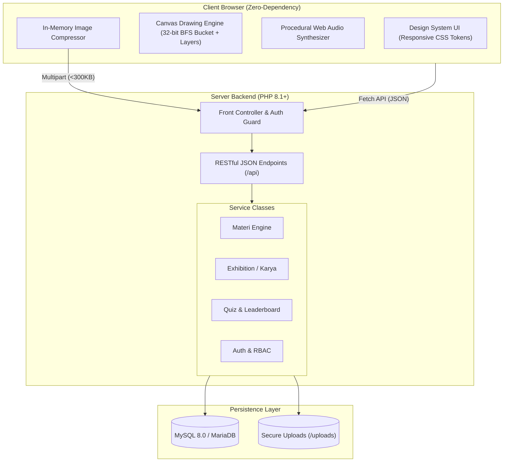

<div align="center">

# 🎨 Digi-Art
### Interactive EdTech Platform & In-Browser Raster Graphics Studio

[](https://php.net)
[](https://developer.mozilla.org/en-US/docs/Web/JavaScript)
[](https://developer.mozilla.org/en-US/docs/Web/API/Canvas_API)
[](https://www.mysql.com/)
[](https://developer.mozilla.org/en-US/docs/Web/API/Web_Audio_API)
[](LICENSE)

<p align="center">
  <b>A full-featured educational web application bridging digital visual art theory with hands-on raster illustration, gamified Kahoot-style quizzes, and educator curation workflows.</b>
</p>

[Key Highlights](#-key-engineering-highlights) •
[Features](#-core-features) •
[System Architecture](#-system-architecture) •
[Demo Credentials](#-default-credentials) •
[Local Installation](#-local-installation-xampp) •
[Deployment](#-production-deployment-infinityfree)

---

</div>

## 📌 Executive Summary

**Digi-Art** is an interactive, zero-external-dependency web application engineered for middle-school digital arts curriculum (Seni Rupa Kelas VIII). Rather than relying on passive video tutorials or heavyweight third-party software, Digi-Art provides an **integrated, browser-native creation environment**: students learn illustration theory, discover reference imagery, produce multi-layer raster artwork via an in-house canvas studio, and submit pieces to a teacher-moderated exhibition gallery.

Designed to run seamlessly on both resource-constrained free hosting (e.g. InfinityFree / shared cPanel) and local network servers, the architecture emphasizes **client-side computation**, **zero external CSS/JS framework dependencies**, and **defensive backend security**.

---

## ⚡ Key Engineering Highlights

### 1. 🖌️ In-Browser Multi-Layer Canvas Drawing Engine
The custom Studio Digital suite is built directly on HTML5 Canvas API without external drawing libraries:
- **32-Bit BFS Flood Fill Engine**: The paint bucket algorithm inspects a 32-bit `Uint32Array` view over raw `ImageData.data` buffers. Executed with a 4-way Breadth-First Search queue, it performs instant, stack-safe flood fills without call-stack recursion overflow.
- **Procedural Brush Shaders**:
  - *Simple Pen*: Solid Bresenham stroke interpolation with round cap joins.
  - *Sketch Pencil*: Stochastic noise jittering simulating graphite grain textures.
  - *Soft Watercolor*: Distance-decay alpha gradient blending for smooth atmospheric shading.
- **Multi-Layer Raster Compositor**: Dynamic layer stacking order, individual layer opacity controls, visibility toggles, and destructive *Merge Down* operations.
- **Touch-Optimized Interaction**: Native hardware acceleration via `touch-action: manipulation`, coordinate re-projection accounting for `devicePixelRatio` and responsive viewport transforms.

### 2. 🗜️ Client-Side In-Memory Image Compression Pipeline
Shared hosting environments frequently impose strict upload limits (e.g. 2 MB - 8 MB) and short execution timeouts ($<10\text{s}$):
- Before raw canvas artwork ($4000\times3000\text{ px}$, raw size $>8\text{ MB}$) is transmitted over HTTP multipart, a client-side Web Worker/Canvas pipeline performs bilinear downsampling and dynamic JPEG/PNG quantization.
- Compresses payload size to **$<300\text{ KB}$** directly in browser memory with negligible perceptual loss, completely eliminating network bottlenecks and server-side memory exhaustion.

### 3. 🔊 Zero-Asset Synthesized Web Audio Engine
- Rather than loading bulky MP3/WAV assets across mobile data networks, the gamified quiz interface utilizes the browser's native **Web Audio API**.
- Audio waveforms (sine, triangle, exponential frequency ramps) are synthesized procedurally in real-time to generate polyphonic feedback chimes, tension ticks, and streak victory arpeggios.

### 4. 🛡️ Defensive Backend Security & Clean Modular PHP
- **Zero-SQL Injection Guarantee**: 100% of database interactions are routed through `PDO` with strict prepared statements and parameter binding.
- **Password Security**: Bcrypt (`PASSWORD_BCRYPT`) hashing with individual salt generation.
- **Role-Based Access Control (RBAC)**: Fine-grained permission guards distinguishing `Admin`, `Guru` (Teacher), and `Murid` (Student) sessions.
- **Storage Lockdown**: The `uploads/` directory is hardened with custom `.htaccess` rules disabling server-side PHP execution, preventing arbitrary code execution from malicious uploads.

---

## 🎯 Core Features

| Module | Description |
|---|---|
| **🎨 Studio Digital** | In-browser raster art studio with multi-layer support, custom brushes, 32-bit flood fill, text overlay tools, color spectrum picker, and draft autosaving (`localStorage` + MySQL sync). |
| **⚡ Gamified Quiz** | Kahoot-style quiz interface featuring 4 colored polygon action buttons, dynamic countdown timer with score decay, answer streak multipliers, and a real-time leaderboard. |
| **🖼️ Curation Gallery** | Public art exhibition with a two-phase moderation pipeline: student submissions enter a `pending` queue and require teacher approval before public display. Includes an appreciation (Like) counter. |
| **🔍 Visual Reference Engine** | Integrated Google Images API web proxy allowing students to browse reference artwork in aspect-ratio normalized preview modals and load them directly into studio layers. |
| **📚 Dynamic Courseware** | Modular learning blocks allowing educators to switch layout modes (*Card Grid*, *Checklist*, *Prose*, or *Step-by-step*) and toggle topic visibility dynamically without altering database schemas. |
| **👨‍🏫 Teacher Command Center** | Dedicated portal for tracking student quiz performance, approving exhibition artwork, managing student credentials, and configuring site-wide curriculum parameters. |

---

## 🏛️ System Architecture



---

## 🔑 Default Credentials

> **Note**: For local development and demonstration purposes, the database seed includes pre-configured demo accounts.

| Role | Username | Password | Privileges |
|:---:|:---:|:---:|---|
| **Administrator** | `admin` | `admin123` | Full administrative control, system settings, database management |
| **Guru Seni Rupa** | `guru` | `guru123` | Artwork moderation queue, curriculum template switcher, student generation |
| **Murid Demo (1)** | `murid` | `murid123` | Access to Studio, Quiz, Gallery submission, self-profile management |
| **Murid Demo (2)** | `budi` | `murid123` | Student account for multi-user leaderboard and exhibition testing |

---

## 💻 Local Installation (XAMPP)

### Prerequisites
- [XAMPP](https://www.apachefriends.org/) (PHP 8.1+ & MySQL / MariaDB)
- Modern web browser (Chrome, Firefox, Safari, Edge)

### Setup Steps
1. **Clone the repository** into your XAMPP web root:
   ```bash
   cd C:/xampp/htdocs   # or D:/XAMPP/htdocs
   git clone https://github.com/revwrks/digi-art.git Digi-Art
   cd Digi-Art
   ```

2. **Database Initialization**:
   - Start **Apache** and **MySQL** in XAMPP Control Panel.
   - Open [phpMyAdmin](http://localhost/phpmyadmin) and create a database named `digi_art`.
   - Import the schema file:
     ```sql
     schema.sql
     ```
   - *(Optional)* To seed mock student accounts, import:
     ```sql
     import_murid_kelas8.sql
     ```

3. **Configuration**:
   - The application automatically detects Localhost/XAMPP environments and connects to `127.0.0.1:3306` with user `root` and an empty password.
   - To configure custom credentials, duplicate `config/config.example.php` to `config/config.php` and adjust your variables:
     ```bash
     cp config/config.example.php config/config.php
     ```

4. **Launch**:
   - Navigate to `http://localhost/Digi-Art/` in your browser.

---

## 🌐 Production Deployment (InfinityFree)

1. Create a MySQL database inside the hosting cPanel (e.g. `epiz_XXXX_digiart`).
2. Import `schema.sql` via phpMyAdmin.
3. Open `config/config.php` and supply your database credentials:
   ```php
   define('DB_HOST', 'sqlXXX.infinityfree.com');
   define('DB_NAME', 'epiz_XXXX_digiart');
   define('DB_USER', 'epiz_XXXX');
   define('DB_PASS', 'your_cpanel_db_password');
   ```
4. Upload all files to the remote `htdocs/` folder via FTP / File Manager.
5. Ensure the `uploads/` directory has write permissions (`0755` or `0777`).

---

## 📄 License

Distributed under the **MIT License**. See [`LICENSE`](LICENSE) for detailed terms.

---

<div align="center">
  <sub>Engineered with passion by <a href="https://github.com/revwrks">revwrks</a>.</sub>
</div>
