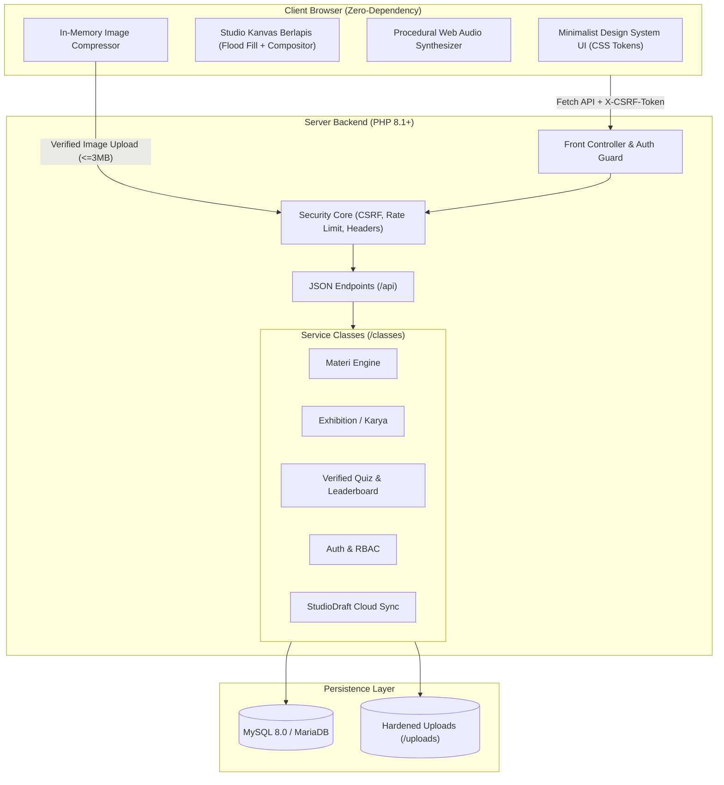

<div align="center">

# Digi-Art
### Interactive EdTech Platform & Studio Kanvas Berlapis (In-Browser Raster Graphics Studio)

[](https://php.net)
[](https://developer.mozilla.org/en-US/docs/Web/JavaScript)
[](https://developer.mozilla.org/en-US/docs/Web/API/Canvas_API)
[](https://www.mysql.com/)
[](https://developer.mozilla.org/en-US/docs/Web/API/Web_Audio_API)
[](LICENSE)

<p align="center">
  <b>A full-featured educational web application bridging digital visual art theory with Digi-Art's native Studio Kanvas Berlapis, Kuis Interaktif, and educator curation workflows.</b>
</p>

[Executive Summary](#executive-summary) •
[Key Highlights](#key-engineering-highlights) •
[Core Features](#core-features) •
[Security Architecture](#security-architecture) •
[System Architecture](#system-architecture) •
[Default Credentials](#default-credentials) •
[Local Installation](#local-installation-xampp) •
[Production Deployment](#production-deployment-infinityfree)

---

</div>

## Executive Summary

**Digi-Art** is an interactive, zero-external-dependency web application built for the middle-school digital arts curriculum (*Seni Rupa Kelas VIII*). Rather than relying on passive tutorials or external desktop software, Digi-Art provides an **integrated, browser-native creation environment** with a clean, minimalist interface: students study illustration theory, browse reference imagery, create multi-layer raster illustrations in the native **Studio Kanvas Berlapis**, test comprehension in **Kuis Interaktif**, and submit original works to a teacher-curated exhibition gallery.

Engineered to run reliably on both local XAMPP networks and resource-constrained shared hosting (such as InfinityFree or cPanel), the codebase emphasizes **client-side computation**, **zero external CSS/JS framework dependencies**, and **defense-in-depth backend security**.

---

## Key Engineering Highlights

### 1. Studio Kanvas Berlapis (In-Browser Multi-Layer Canvas Engine)
Digi-Art's native Studio Digital (`assets/js/studio.js`) is built directly on the HTML5 Canvas API without third-party drawing libraries:
- **Flood Fill Engine**: 4-way stack-safe Breadth-First Search flood fill operating directly over `ImageData.data` pixel buffers with configurable color tolerance.
- **Procedural Brush Shaders & Per-Tool Profiles**:
  - *Simple Pen*: Solid round-cap stroke interpolation on an isolated scratchpad canvas to prevent alpha-overlap artifacts.
  - *Sketch Pencil*: Stochastic jitter strokes simulating graphite texture.
  - *Soft Brush (Cat Air)*: Soft shadow-blurred strokes for smooth atmospheric shading.
  - *Airbrush*: Radial gradient spray interpolation along pointer paths.
  - *Eraser, Shape Tool, Move Layer, & 1:1 Movable Text*: Complete raster toolset with exponential moving-average touch stabilization.
- **Multi-Layer Raster Compositor**: Dynamic layer stacking order, drag-and-drop and step reordering, per-layer opacity and visibility controls, *Merge Down*, composition grids (Rule of Thirds 3x3 & 8x8), and reference-layer isolation (anti-plagiarism filtering when exporting to the gallery).
- **Touch & Viewport Ergonomics**: Pinch-to-zoom, two-finger pan, wheel zoom, responsive auto-fit scaling, and per-account draft autosave (`localStorage` + MySQL `studio_drafts` cloud sync).

### 2. Client-Side In-Memory Image Compression Pipeline
Shared hosting environments commonly enforce tight upload limits and short PHP execution timeouts:
- Before artwork is uploaded via `api/upload.php`, `assets/js/compressor.js` downsamples and encodes images in browser memory.
- Reduces multipart/base64 payloads dramatically before transmission, avoiding server memory exhaustion and network bottlenecks.

### 3. Zero-Asset Synthesized Web Audio Engine
- The **Kuis Interaktif** module uses the browser's native **Web Audio API** (`assets/js/quiz-kahoot.js`) to synthesize chimes, countdown ticks, and streak feedback procedurally with zero external audio files.

---

## Core Features

| Module | Description |
|---|---|
| **Studio Kanvas Berlapis** | Native in-browser raster illustration studio with multi-layer compositing, custom brushes, flood fill, geometry shapes, movable 1:1 text overlays, color spectrum picker, PNG/JPG export, and per-account cloud draft autosave. |
| **Kuis Interaktif** | Native interactive quiz featuring 4 color-coded action cards, per-question countdown timers, streak multipliers, synthesized Web Audio feedback, server-verified scoring, and a live leaderboard. |
| **Galeri Pameran & Kurasi** | Public art exhibition with a two-phase moderation pipeline: student submissions enter a `pending` queue and require teacher/admin approval before public display, with session-deduplicated appreciation counters. |
| **Pencarian Referensi Visual** | Integrated visual reference browser (`classes/ReferensiEngine.php` & `classes/BankReferensi.php`) allowing students to inspect reference images and import them into dedicated studio reference layers. |
| **Materi Pembelajaran Dinamis** | Modular courseware where educators can switch layout modes (*Cards*, *List*, *Prose*, *Steps*), toggle card visibility, customize chapter headers, and manage sections without database schema edits. |
| **Dashboard Guru & Admin** | Centralized management panel for curating gallery submissions, managing learning materials and quiz banks, creating/editing user accounts with strict role hierarchy, auditing activity logs, and toggling demo access mode. |

---

## Security Architecture

Digi-Art enforces layered security controls centered around `classes/Security.php`, `config/config.php`, and directory-level `.htaccess` rules:

- **CSRF Protection on All Mutating Endpoints (`classes/Security.php`)**:
  - Per-session 32-byte cryptographic tokens (`Security::csrfToken()`) exposed via `<meta name="csrf-token">` in `includes/header.php`.
  - Every state-changing API endpoint (`api/pameran.php`, `api/materi.php`, `api/quiz.php`, `api/users.php`, `api/settings.php`, `api/studio.php`, `api/upload.php`, `api/auth.php`) enforces `Security::requireMethod('POST')` and `Security::requireCsrf()`, verifying `X-CSRF-Token` headers or `_csrf` payload tokens with `hash_equals()`.
  - Frontend modules (`assets/js/app.js`, `assets/js/dashboard.js`, `assets/js/studio.js`) attach the CSRF header automatically.
- **Sliding-Window Login Rate Limiting (`classes/Security.php` & `classes/Auth.php`)**:
  - Tracks failed login attempts per client IP and normalized username (`RATE_LIMIT_MAX_ATTEMPTS = 8` attempts within a `600`-second sliding window), returning a retry countdown when exceeded and regenerating session IDs + CSRF tokens upon successful login.
- **`APP_DEBUG` Leak Prevention (`config/config.php` & `classes/Database.php`)**:
  - In production (`APP_ENV=production` / `APP_DEBUG=false`), PHP `display_errors` is disabled and `Database` connection failures log details internally via `error_log()` while returning sanitized generic messages to browsers and API clients.
- **Strict Image Upload Verification (`api/upload.php`)**:
  - Enforces authentication, a 3 MB payload limit, binary magic-byte MIME inspection via `finfo_buffer(FILEINFO_MIME_TYPE)` (`image/jpeg`, `image/png`, `image/webp` only), and image integrity/dimension checks (`<= 4096x4096`) via `getimagesizefromstring()`, ignoring user-supplied filenames/extensions.
- **Path Containment on Deletions (`classes/Karya.php`)**:
  - `Karya::delete()` resolves canonical paths with `realpath()` and verifies strict containment inside `UPLOAD_DIR` before unlinking files, and `Karya::submitWork()` validates paths via `Security::isSafeUploadPath()`.
- **Server-Side Anti-Cheat Quiz Verification (`classes/Quiz.php` & `api/quiz.php`)**:
  - `Quiz::getQuestionsForPlay()` strips `correct_index` from client payloads and initializes `$_SESSION['quiz_attempt']`.
  - `Quiz::checkAnswer()` verifies question membership, blocks duplicate submissions for the same question, clamps `time_left` to `time_limit`, and computes points and streaks exclusively on the server before `Quiz::submitVerifiedScore()` saves the score.
- **URL & Output Sanitization**:
  - `Security::isSafeAssetOrHttpsUrl()` restricts custom artwork/material URLs to safe relative paths (`assets/`, `uploads/`) or `https://` URLs, blocking `javascript:`, `data:`, `http://`, traversal (`..`), and control characters.
  - All dashboard and studio dynamic templates escape user/database strings via `escapeHTML()` and pass numeric IDs in event handlers.
- **`.htaccess` Hardening & HTTP Security Headers**:
  - Root `.htaccess` denies direct HTTP access to `.sql`, `.csv`, `.env`, `.md`, `.json`, `.log`, `.bak`, `.config`, `.ini`, `.sh`, `.inc`, `.dist`, `.pdf`, `.git*`, and explicit data/docs files (`daftar_akun_murid_kelas8.csv`, `import_murid_kelas8.sql`, `update_terakhir.sql`, `schema.sql`, `README.md`, `LICENSE`).
  - Subdirectory `.htaccess` files deny all direct HTTP access to `config/`, `classes/`, `includes/`, `pages/`, and `Guidelines/`.
  - `uploads/.htaccess` disables the PHP engine (`php_flag engine off`), blocks executable/active extensions (`.php`, `.phtml`, `.phar`, `.html`, `.svg`, `.js`, etc.), and adds `X-Content-Type-Options: nosniff` + restrictive CSP.
  - `Security::sendSecurityHeaders()` emits `X-Content-Type-Options: nosniff`, `X-Frame-Options: SAMEORIGIN`, `Referrer-Policy`, `Permissions-Policy`, and `Content-Security-Policy` headers, alongside strict `HttpOnly` / `SameSite=Lax` session cookie settings.

---

## System Architecture



---

## Default Credentials

> **Note**: For local development and demonstration purposes, `schema.sql` seeds pre-configured accounts. Administrators can enable or disable demo accounts (`murid`, `guru`, `budi`, `ratna`) at any time from **Dashboard > Pengaturan Akses**.

| Role | Username | Password | Privileges |
|:---:|:---:|:---:|---|
| **Administrator** | `admin` | `admin123` | Full administrative control, user & role management, site settings, demo-mode toggle |
| **Guru Seni Rupa** | `guru` | `guru123` | Artwork moderation queue, curriculum editor, quiz bank CRUD, student account management |
| **Murid Demo (1)** | `murid` | `murid123` | Access to Studio Kanvas Berlapis, Kuis Interaktif, gallery submission, self-profile management |
| **Murid Demo (2)** | `budi` | `murid123` | Student account for multi-user leaderboard and exhibition testing |
| **Murid Demo (3)** | `ratna` | `murid123` | Student account for multi-user leaderboard and exhibition testing |

---

## Environment Configuration

Digi-Art supports zero-dependency environment configuration in `config/config.php` using either:
1. **`.env` file** at the project root (copy `.env.example` to `.env`), or
2. **`config/config.local.php`** (gitignored PHP override file defining constants such as `APP_ENV`, `APP_DEBUG`, `DB_HOST`, `DB_NAME`, `DB_USER`, `DB_PASS`, `DB_PORT`).

**Environment Auto-Detection (`config/config.php`)**:
- `config/config.php` respects an explicit `APP_ENV` (`local` or `production`) if configured.
- Otherwise, it distinguishes local XAMPP/LAN environments (loopback hosts, private IP ranges, Windows, or local `C:/xampp` / `D:/xampp` paths) from production hosting domains (`.epizy.com`, `.infinityfree.me`, `.rf.gd`, `.great-site.net`, `.42web.io`) **without checking for `/htdocs/` in file paths** (avoiding the false-positive local detection bug on InfinityFree/cPanel servers that also deploy under `/htdocs/`).

---

## Local Installation (XAMPP)

### Prerequisites
- [XAMPP](https://www.apachefriends.org/) (PHP 8.1+ & MySQL / MariaDB)
- Modern web browser (Chrome, Firefox, Safari, Edge)

### Setup Steps
1. **Clone the repository** into your XAMPP web root:
   ```bash
   cd D:/XAMPP/htdocs   # or C:/xampp/htdocs
   git clone https://github.com/revwrks/digi-art.git Digi-Art
   cd Digi-Art
   ```

2. **Database Initialization**:
   - Start **Apache** and **MySQL** in the XAMPP Control Panel.
   - Open [phpMyAdmin](http://localhost/phpmyadmin) and create a database named `digi_art`.
   - Import `schema.sql` into `digi_art`.
   - *(Optional)* To seed the classroom student roster, import `import_murid_kelas8.sql` (and `update_terakhir.sql` if applying incremental updates).

3. **Environment Configuration**:
   - Out of the box, local XAMPP connects to `127.0.0.1:3306` with database `digi_art`, user `root`, and an empty password.
   - To customize database credentials or optional Google Custom Search API keys (`GOOGLE_API_KEY`, `GOOGLE_SEARCH_CX`), copy `.env.example` to `.env` or create `config/config.local.php`:
     ```bash
     cp .env.example .env
     ```

4. **Launch**:
   - Open `http://localhost/Digi-Art/` in your browser.

---

## Production Deployment (InfinityFree / cPanel)

1. Create a MySQL database inside your hosting control panel (e.g., `epiz_XXXX_digiart`).
2. Import `schema.sql` via phpMyAdmin (and optionally `import_murid_kelas8.sql`).
3. Configure production credentials using **`.env`** or **`config/config.local.php`** (recommended so tracked files remain clean), or update fallback values in `config/config.php`:
   ```ini
   # .env (production)
   APP_ENV=production
   APP_DEBUG=0

   DB_HOST=sqlXXX.infinityfree.com
   DB_NAME=epiz_XXXX_digiart
   DB_USER=epiz_XXXX
   DB_PASS=your_cpanel_db_password
   DB_PORT=3306
   ```
   Alternatively, create `config/config.local.php`:
   ```php
   <?php
   define('APP_ENV', 'production');
   define('APP_DEBUG', false);
   define('DB_HOST', 'sqlXXX.infinityfree.com');
   define('DB_NAME', 'epiz_XXXX_digiart');
   define('DB_USER', 'epiz_XXXX');
   define('DB_PASS', 'your_cpanel_db_password');
   ```
4. Upload the project files to the remote `htdocs/` directory via FTP / File Manager (avoid uploading local `.git/` or unneeded scratch files; keep `.htaccess` files intact).
5. Ensure the `uploads/` directory is writable by the web server (`0755` or `0777`) and keep `uploads/.htaccess` in place.
6. Log in as `admin` immediately after deployment, change default passwords, and disable demo accounts under **Dashboard > Pengaturan Akses** if running a live classroom.

---

## License

Distributed under the **MIT License**. See [`LICENSE`](LICENSE) for detailed terms.

---

<div align="center">
  <sub>Engineered by <a href="https://github.com/revwrks">revwrks</a>.</sub>
</div>
